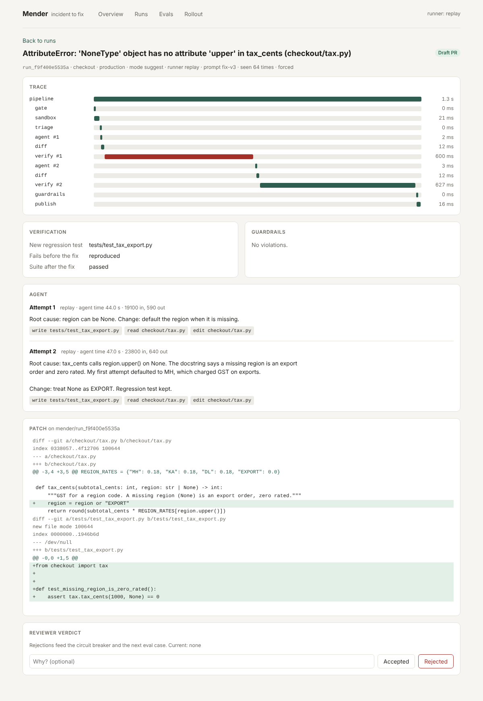

# Mender

An incident to fix pipeline built on the Cursor agent. A production error comes in,
Mender checks out the service in a sandbox, drives the Cursor CLI to reproduce and
fix it, proves the fix, runs guardrails over the diff, and opens a pull request with
the evidence attached. Everything is traced, measured, evaluated and gated behind
rollout controls.

It is the "incident → fix pipeline" from the Cursor Forward Deployed Engineer job
description, built the way that role describes the work: discovery and success
metrics first, a fast first version, then the parts that make it safe to run on a
real team's repository.

```
Sentry-style webhook
        │
        ▼
  ingest ─ validate, HMAC check, fingerprint, dedupe
        │
        ▼
  gate ─ kill switch · service mode · sampling · circuit breaker
        │
        ▼
  sandbox ─ isolated checkout + pristine base worktree
        │
        ▼
  triage ─ stack frames → code context (path-traversal safe)
        │
        ▼
  agent ─ `agent -p --force --output-format stream-json`   ◄── retry once with
        │                                                      test output
        ▼
  verify ─ new test must FAIL on base, full suite must PASS on patch
        │
        ▼
  guardrails ─ broad except · test tampering · skip markers · forbidden paths
        │       dependency changes · secrets · diff size
        ▼
  publish ─ shadow: record only │ suggest: draft PR │ auto_pr: ready PR
```



More screens: [overview](docs/screenshots/overview.png), [evals](docs/screenshots/evals.png), [rollout](docs/screenshots/rollout.png).

## Quick start

Needs Python 3.11+, Node 20+ and git. No API key is needed for the first run.

```bash
make install      # backend (editable) and dashboard packages
make check        # 32 tests, the eval gate, dashboard type-check and build
make demo         # one run per fixture incident
make serve        # http://127.0.0.1:8787
```

Send an incident by hand:

```bash
curl -X POST localhost:8787/api/incidents -H 'content-type: application/json' \
  -d @fixtures/incidents/pricing-zero-qty.json
```

### Running against the real Cursor agent

```bash
curl https://cursor.com/install -fsS | bash
export CURSOR_API_KEY=...
export MENDER_RUNNER=cursor
make eval-cursor          # model numbers on the 7 eval cases
make serve                # live pipeline
```

To point it at your own repository, add a service to `mender.yaml` (a local path
or a git URL, plus the test command) and send incidents with that service name.

## Two runners, and what each one proves

| Runner | What it is | What its numbers mean |
| --- | --- | --- |
| `cursor` | The real Cursor CLI in headless mode | Model quality on your code |
| `replay` | Hand-written edits from `fixtures/replays/` | Whether the harness catches bad patches |

The replay runner exists so the pipeline can be tested in CI without spending
tokens. Four of its seven scripts are deliberately flawed: a swallowed exception,
an edited test, a wrong first attempt, and a plausible fix that only covers the
reported input. Replay results say nothing about how good the model is.

**What has been run:** the full test suite, the eval suite and the dashboard, all
on the replay runner, plus the Cursor runner against a fake CLI binary that emits
the documented event stream.
**What has not been run:** the Cursor runner against the real service (it needs an
API key), the GitHub push path behind `MENDER_PUBLISH=1`, and the Docker build.
Expect to adjust `parse_stream` if the CLI's event shapes differ from the docs.

## Current eval result (replay runner)

```
ok  pricing-zero-qty        resolved        pr_draft   attempts=1
ok  currency-lowercase      resolved        pr_draft   attempts=1
ok  inventory-unknown-sku   correct_block   blocked    broad_except
ok  cart-empty              correct_block   blocked    test_tampering
ok  tax-missing-region      resolved        pr_draft   attempts=2
ok  coupon-percent-sign     false_fix       pr_draft   attempts=1
ok  shipping-drone          no_fix          no_fix
resolve_rate=0.429  false_fix_rate=0.25
```

The false fix is kept on purpose. It reproduces the incident, passes the suite and
trips no guardrail, and it is still wrong. Only a held-out contract test exposes
it. That gap is why `auto_pr` never merges and a human reviews every PR. See
`docs/FAILURE_MODES.md`.

## How this maps to the job description

| The role asks for | Where it is |
| --- | --- |
| Lead discovery, find the real bottleneck, define success metrics | `docs/DISCOVERY.md` |
| Build Cursor-powered workflows (incident → fix) | `backend/mender/pipeline.py`, `runners/cursor_cli.py`, `prompts.py` |
| Fast first version, then harden with rollout plans | `docs/ROLLOUT.md`, `backend/mender/rollout.py` |
| Tracing | `tracing.py`, trace waterfall on every run page |
| Evals | `evals.py`, `fixtures/evals/`, CI gate |
| Metrics, monitoring, alerts | `metrics.py`, `/metrics`, `ops/alerts.yml` |
| Debugging model behaviour | per-attempt agent text, tool calls, tokens and test output on the run page |
| Latency and cost tradeoffs, failure modes | `docs/FAILURE_MODES.md` |
| Incident response, safe rollouts | `docs/RUNBOOK.md`, kill switch, circuit breaker, shadow mode |
| Communicate tradeoffs and results to eng leaders | Overview and Evals pages, PR body with evidence |
| Reusable patterns, push improvements back into Cursor | `docs/PATTERNS.md`, `.cursor/rules/incident-fix.mdc` |
| Python and TypeScript, frontend to infra | `backend/` (FastAPI), `dashboard/` (React + TypeScript), `Dockerfile`, CI |

## Layout

```
backend/mender/     pipeline, runners, verification, guardrails, rollout, tracing, evals, API, CLI
backend/tests/      32 tests: guardrail rules, rollout logic, CLI parsing, pipeline and API end to end
dashboard/          React + TypeScript console: overview, runs, trace and diff, evals, rollout
fixtures/           sample checkout service with 7 latent bugs, captured incidents, replays, eval cases
docs/               discovery, rollout plan, runbook, failure modes, reusable patterns
ops/                Prometheus scrape config and alert rules
```

## API

| Method | Path | Purpose |
| --- | --- | --- |
| POST | `/api/incidents` | Webhook. Returns `run_id`, or the existing run when the incident is a duplicate |
| GET | `/api/runs`, `/api/runs/{id}` | Runs, with spans, diff, verification and guardrail results |
| POST | `/api/runs/{id}/feedback` | Reviewer verdict: accepted or rejected |
| GET | `/api/stats` | Fix rate, accept rate, time to fix, cost, stage latency |
| GET, PUT | `/api/rollout`, `/api/rollout/{service}`, `/api/rollout/kill-switch` | Rollout controls |
| GET, POST | `/api/evals`, `/api/evals/run` | Eval history, start a run |
| GET | `/metrics`, `/healthz` | Prometheus metrics, health |

The control endpoints have no authentication of their own. Put the service behind
your SSO proxy or VPN before exposing it; only the webhook has an HMAC check.
